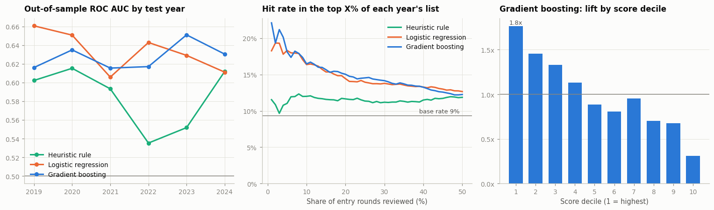
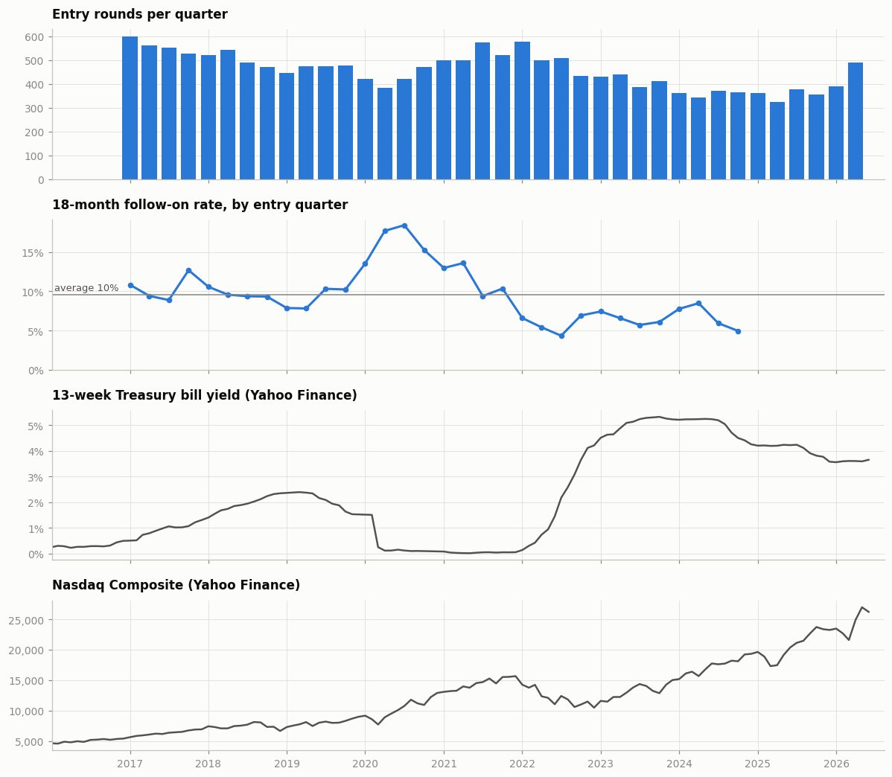
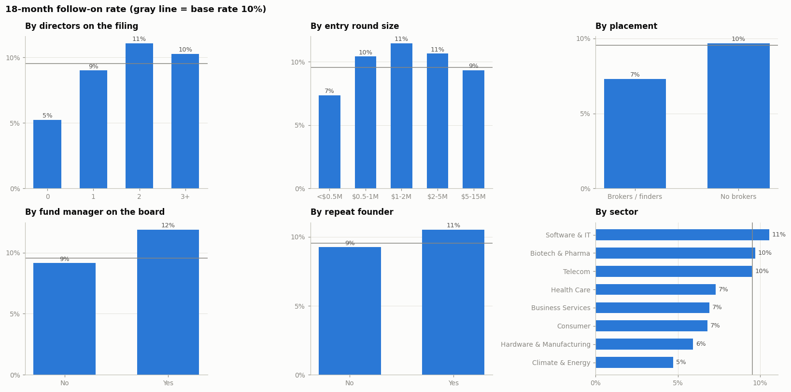

# Early-Stage Deal Sourcing from SEC Form D Filings

**Which startups that just raised their first round will raise a bigger one within 18 months?**

This project turns the SEC's public Form D filings into a deal-sourcing model for a seed-stage venture fund. It rebuilds private funding rounds from raw filings, identifies each young company's first raise, links its board members to venture fund filings, and ranks companies by their likelihood of raising a larger follow-on round. Everything runs in one Google Colab notebook on free public data.

## Results

Tested walk-forward with an embargo: the model was chosen on 2019–2021 and evaluated on 2022–2024, years it never influenced.

| Held-out years 2022–2024 | Hit rate in yearly top 100 | Lift vs base rate | ROC AUC |
|---|---|---|---|
| Base rate (random pick) | 6.3% | 1.0x | 0.50 |
| Standard VC checklist | 7.0% | 1.1x | 0.57 |
| **Model (gradient boosting)** | **13.0%** | **2.1x** | **0.63** |

- **Data:** 538,768 Form D filings (Q1 2016 to Q2 2026), rebuilt into 70,767 funding rounds and 17,366 first rounds of young venture companies.
- **Live check:** among recent companies at least 9 months past their first raise, 7.0% of the model's top 100 had already raised a larger round, vs 4.6% overall.
- **A standard analyst checklist** (Delaware C-corp, tech hub, $1M+ round, board member, no brokers) did no better than random on the held-out years.

## Why Form D

US companies raising money privately under Regulation D must file a Form D with the SEC within 15 days of the first sale. The filings list the company, industry, location, round size, number of investors, type of security, and the names and roles of officers and directors. The SEC publishes them as quarterly structured data sets, which makes Form D a free, point-in-time record of US private fundraising.

## Method

1. **Download and audit** every quarterly Form D data set from SEC EDGAR, checking that no rows are lost in parsing.
2. **Define the venture universe:** remove investment funds, M&A filings, non-venture industries and partnership structures.
3. **Rebuild funding rounds:** link each amendment back to the original notice through its chain of previous filing numbers, so annual updates aren't mistaken for new rounds.
4. **Entry rounds:** each young company's first observed raise, $100k to $15M, incorporated within 5 years.
5. **Label:** did the company file a new round at least 1.5x larger and at least $1M within 18 months?
6. **Features, all point-in-time:** round size, investor count and average check, directors and officers, brokers, security type, filing speed, legal structure, location, sector, plus a **board network**: directors who manage VC funds (matched against fund Form D filings), repeat founders, and board experience.
7. **Validation:** walk-forward by year with an embargo, so no model trains on outcomes that were unknown at the time. Models: logistic regression, gradient boosting, and a heuristic checklist baseline.
8. **Watchlist:** the chosen model scores companies still inside their 18-month window, with probabilities recalibrated to recent market conditions.

The funding climate (short-term rates and the Nasdaq, from FRED and Yahoo Finance) is shown as context. It explains why base rates swing from about 16% for 2020 entrants to about 6% in 2022–2024.

## How to run

1. Open [Google Colab](https://colab.research.google.com), choose **File → Open notebook → GitHub**, and paste this repository's URL. Or download `vc_deal_sourcing_form_d.ipynb` and upload it.
2. In the configuration cell, set `SEC_USER_AGENT` to your name and email. The SEC requires automated requests to identify themselves.
3. Choose **Runtime → Run all**. The full run takes a few minutes; downloaded files are cached.

Data sources: [SEC Form D data sets](https://www.sec.gov/data-research/sec-markets-data/form-d-data-sets), [FRED](https://fred.stlouisfed.org), Yahoo Finance (via `yfinance`).

## Limitations

- Not every private round files a Form D, and a larger follow-on round is a proxy for traction, not for company quality or returns.
- Form D doesn't name a round's investors; the fund-manager signal relies on name matching, which is noisy.
- The signal is modest (ROC AUC 0.63). It's useful for ranking a shortlist, not for predicting individual outcomes.
- Results depend on hand-set definitions (18-month window, 1.5x step-up, $1M floor).

## Next steps

- Probabilistic entity resolution and a co-investment graph of funds, partners and companies.
- A survival (time-to-next-round) model with fully calibrated probabilities.
- Daily ingestion of new Form D filings for real-time sourcing alerts.

---

*Author: Nico Picech. Built for educational purposes; not investment advice.*
